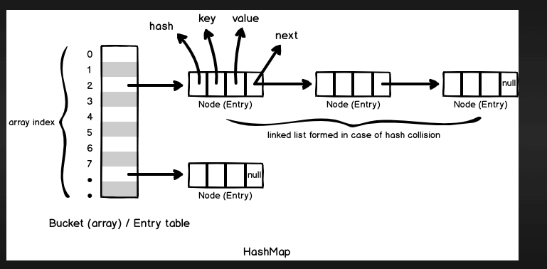

# Buckets, HashMap, and ConcurrentHashMap

A **HashMap** stores key-value pairs so you can look up a value quickly using its key. A **Hash Function** converts each key into an array index that points to a **bucket** where the entry is stored.

## Structure
- **1 HashMap → many buckets:** The map maintains an array of slots (buckets), such as `0, 1, 2, ..., 15`, and resizes as needed.
- **1 bucket → 0, 1, or more key-value entries:** A bucket can be empty (`null`), hold a single entry, or chain multiple entries together when multiple keys map to the same index.

For example, if both `"apple" -> 1` and `"banana" -> 2` hash to **Bucket 2**, both entries can live in that same bucket.

## Concurrent Insertions into the Same Bucket
Suppose two threads insert two different keys (`"apple" -> 1` and `"banana" -> 2`) into the same bucket at the exact same time:

- **With `HashMap`:** There is no coordination to protect concurrent updates. Thread B can overwrite Thread A's update, resulting in only 1 entry instead of 2 and causing data loss.
- **With `ConcurrentHashMap`:** Bucket-level synchronization/atomic updates protect the bucket automatically without requiring manual lock code for basic `put` operations. Thread A adds `"apple" -> 1` and Thread B safely adds `"banana" -> 2` alongside it, preserving both entries in the map.